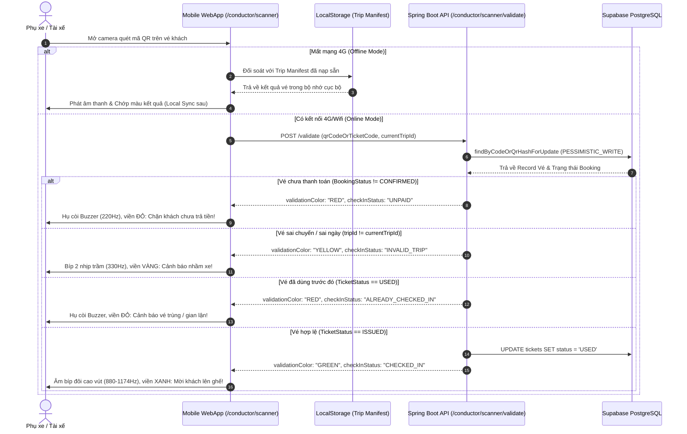

# 📘 KIẾN TRÚC, LUỒNG HOẠT ĐỘNG VÀ LOGIC: QUÉT QR SOÁT VÉ WEBAPP DI ĐỘNG & ĐỊNH VỊ GPS LIVE TRACKING

> **Dự án:** TravelEasy Platform — Nền Tảng Đặt Vé & Quản Lý Nhà Xe Liên Tỉnh  
> **Tác giả tài liệu:** Đoàn Nhật Cường (`@joshliam`) & Nhóm phát triển TravelEasy  
> **Phạm vi phân hệ:** 
> - **[S320] WebApp Quét QR Soát Vé & Điểm Danh Hành Khách Lên Xe** (`/conductor/scanner`)
> - **[S306 / S419] Bản Đồ Định Vị GPS Live Tracking Xe Chạy Thời Gian Thực** (`/tracking`, `/tracking/:tripId`)

---

## 📑 1. CÁC TÀI LIỆU DỰ ÁN LIÊN QUAN (DOCS MAPPING)

Bạn có thể đối chiếu các đặc tả nghiệp vụ, biên bản kiểm thử và thiết kế CSDL trong thư mục `docs/`:

1. **Đặc tả luồng nghiệp vụ & kịch bản:**
   - [DAC_TA_LUONG_NGHIEP_VU_BO_SUNG_SPRINT_3.md](file:///d:/class%20things/OJT-IV/traveleasy-platform/docs/01-requirements/DAC_TA_LUONG_NGHIEP_VU_BO_SUNG_SPRINT_3.md#L109-L125) (Mục 2.5: Luồng S320 Web Mobile Quét QR Soát Vé Cho Phụ Xe).
   - [BO_DU_LIEU_CHUAN_HOA_BAO_VE_D-DAY.md](file:///d:/class%20things/OJT-IV/traveleasy-platform/docs/04-agile-and-sprints/BO_DU_LIEU_CHUAN_HOA_BAO_VE_D-DAY.md#L100-L140) (Mục 4.1: Bản đồ giám sát GPS Tracking trực tuyến và xe 51B-889.99).
   - [RA_SOAT_LOI_LOGIC_VA_XUNG_DOT_SPRINT_3.md](file:///d:/class%20things/OJT-IV/traveleasy-platform/docs/06-business-logic-audits/RA_SOAT_LOI_LOGIC_VA_XUNG_DOT_SPRINT_3.md#L150-L170) (Mục BUG-NEW-05: Điểm mù ngoại tuyến Offline Blindspot khi xe qua đèo núi).

2. **Cấu trúc CSDL & DDL:**
   - [schema.sql](file:///d:/class%20things/OJT-IV/traveleasy-platform/docs/02-architecture-and-db/schema.sql) (Bảng `tickets`, `trips`, cột `last_gps_updated_at`, `check_in_status`, index tối ưu hóa `trip_id, seat_code`).
   - [MIGRATION_SPRINT_4_EXTENSIONS.sql](file:///d:/class%20things/OJT-IV/traveleasy-platform/docs/02-architecture-and-db/MIGRATION_SPRINT_4_EXTENSIONS.sql).

3. **Báo cáo kiểm thử & nghiệm thu:**
   - [SPRINT_3_README.md](file:///d:/class%20things/OJT-IV/traveleasy-platform/docs/04-agile-and-sprints/SPRINT_3_README.md) & [SPRINT_4_README.md](file:///d:/class%20things/OJT-IV/traveleasy-platform/docs/04-agile-and-sprints/SPRINT_4_README.md).
   - [S320_TEST_REPORT.md](file:///d:/class%20things/OJT-IV/traveleasy-platform/docs/test-reports/duc/S320_TEST_REPORT.md).

---

## 📱 2. PHÂN HỆ QUÉT MÃ QR SOÁT VÉ WEBAPP DI ĐỘNG (S320)

### 2.1. File nguồn triển khai
- **Frontend WebApp:**
  - [QrTicketScannerPage.tsx](file:///d:/class%20things/OJT-IV/traveleasy-platform/frontend/src/pages/conductor/QrTicketScannerPage.tsx) (Giao diện Mobile camera scanner, audio feedback, danh sách sơ đồ ghế trực quan).
  - [ConductorScannerService.ts](file:///d:/class%20things/OJT-IV/traveleasy-platform/frontend/src/pages/conductor/ConductorScannerService.ts) (Tầng API service và cơ chế lưu cache Offline Trip Manifest).
- **Backend Spring Boot:**
  - [ConductorScannerController.java](file:///d:/class%20things/OJT-IV/traveleasy-platform/backend/src/main/java/com/traveleasy/controller/conductor/ConductorScannerController.java) (API `GET /api/v1/conductor/scanner/trips/{tripId}/manifest` và `POST /api/v1/conductor/scanner/validate`).
  - [TicketRepository.java](file:///d:/class%20things/OJT-IV/traveleasy-platform/backend/src/main/java/com/traveleasy/repository/TicketRepository.java) (Query khóa bi quan `PESSIMISTIC_WRITE` chống soát vé đồng thời).

---

### 2.2. Sơ đồ Luồng hoạt động Soát vé (Sequence Diagram)



---

### 2.3. Logic nghiệp vụ chi tiết

1. **Nhận diện mã vé đa kênh:**
   - **Qua Camera:** Quét chuỗi QR (ví dụ `QR-CT-xxx-xxx` hoặc hash base64 in trên vé giấy / app khách hàng).
   - **Nhập thủ công (Fallback):** Nhập 6 ký tự mã vé khi camera mờ, điện thoại trời tối hoặc camera dính bụi bẩn.
2. **Khóa chống soát vé đồng thời (Anti Race-Condition Lock):**
   - Áp dụng `@Lock(LockModeType.PESSIMISTIC_WRITE)` trên `TicketRepository.findByCodeOrQrHashForUpdate`.
   - Nếu khách hàng chia sẻ ảnh QR cho người khác và cùng lúc đưa cho 2 phụ xe quét ở 2 cửa xe khác nhau, chỉ có 1 request được xử lý, request thứ 2 ngay lập tức bị chặn với cờ `ALREADY_CHECKED_IN`.
3. **Phản hồi bằng Âm thanh & Màu sắc tức thì (Web Audio API):**
   - Không cần tải file MP3 (tránh delay mạng). Dùng bộ dao động âm `AudioContext` của trình duyệt:
     - **Màu Xanh lá (Hợp lệ):** Âm bíp đôi trong trẻo (880Hz $\rightarrow$ 1174.66Hz).
     - **Màu Vàng (Sai chuyến/ngày):** 2 hồi âm cảnh báo trầm (440Hz $\rightarrow$ 330Hz).
     - **Màu Đỏ (Vé giả, hủy, đã quét, chưa thanh toán):** Còi báo động sóng răng cưa `sawtooth` (220Hz).
4. **Cơ chế lưu đệm ngoại tuyến (Offline-First Trip Manifest - BUG-NEW-05):**
   - Trước khi xe rời bến, phụ xe nhấn **Đồng bộ danh sách khách**.
   - API `GET /trips/{tripId}/manifest` tải toàn bộ sơ đồ ghế, tên khách, số điện thoại, điểm đón/trả và mã vé vào `localStorage` (`traveleasy_conductor_manifest_<tripId>`).
   - Khi xe đi vào vùng núi đèo mất sóng 4G (`navigator.onLine === false`), hệ thống tự động chuyển sang `validateOffline`, đối soát trực tiếp trên bộ nhớ cục bộ và ghi nhận `checkedIn = true`.

---

## 🗺️ 3. PHÂN HỆ ĐỊNH VỊ GPS LIVE TRACKING XE CHẠY THỜI GIAN THỰC (S306 / S419)

### 3.1. File nguồn triển khai
- **Frontend:**
  - [LiveTrackingMapPage.tsx](file:///d:/class%20things/OJT-IV/traveleasy-platform/frontend/src/pages/customer/tracking/LiveTrackingMapPage.tsx) (Giao diện Bản đồ Leaflet OpenStreetMap, tích hợp nút Re-center S419, kết nối SSE stream, thẻ thông tin tổ lái, nồng độ cồn, vận tốc).
- **Backend Spring Boot:**
  - [TripGpsController.java](file:///d:/class%20things/OJT-IV/traveleasy-platform/backend/src/main/java/com/traveleasy/controller/customer/TripGpsController.java) (Các endpoints REST & SSE stream: `/api/v1/tracking/{tripId}/stream`, `/api/v1/tracking/{tripId}/current`, `/api/v1/tracking/{tripId}/update-location`).
  - [TripGpsRealtimeService.java](file:///d:/class%20things/OJT-IV/traveleasy-platform/backend/src/main/java/com/traveleasy/service/realtime/TripGpsRealtimeService.java) (Quản lý pool SseEmitter, thuật toán nội suy tọa độ GPS trên đa giác lộ trình Polyline, tính toán ETA & vận tốc).

---

### 3.2. Sơ đồ Luồng phát & Nhận tín hiệu GPS (Realtime Architecture)

```mermaid
flowchart TD
    subgraph Driver_Vehicle ["Phương tiện & Tài xế"]
        GPS_Device["Thiết bị GPS hộp đen / Điện thoại tài xế"]
        Driver_App["Giao diện tài xế phát GPS (/conductor/scanner)"]
        Sim_Step["Bộ giả lập di chuyển cao tốc (/simulate-step)"]
    end

    subgraph Backend_Server ["Backend Spring Boot"]
        GpsController["TripGpsController (/api/v1/tracking)"]
        GpsService["TripGpsRealtimeService"]
        SsePool["ConcurrentHashMap<TripId, List<SseEmitter>>"]
        DB[(PostgreSQL trips.last_gps_updated_at)]
    end

    subgraph Client_Viewer ["Khách hàng & Ban điều hành"]
        Web_Map["Khách xem bản đồ Leaflet (/tracking/:tripId)"]
        Recenter_Btn["Nút Căn chỉnh xe về tâm (Re-center FAB S419)"]
        Admin_Radar["Radar giám sát đội xe Admin (/admin/tracking)"]
    end

    GPS_Device -->|HTTP POST Tọa độ [Lat, Lng]| GpsController
    Driver_App -->|Geolocation API HTML5| GpsController
    Sim_Step -->|Mô phỏng từng bước| GpsController

    GpsController --> GpsService
    GpsService -->|Cập nhật snapshot| DB
    GpsService -->|Đẩy event SSE 1s/lần| SsePool

    SsePool -->|text/event-stream| Web_Map
    SsePool -->|text/event-stream| Admin_Radar

    Web_Map -->|map.panTo(carPos)| Recenter_Btn
```

---

### 3.3. Logic nghiệp vụ chi tiết

1. **Cơ chế Truyền tải Dữ liệu Siêu Tốc (Server-Sent Events - SSE):**
   - Khác với WebSocket hai chiều phức tạp, SSE sử dụng giao thức HTTP đơn hướng chuẩn (`text/event-stream`), nhẹ hơn và tự động khôi phục kết nối khi xe qua vùng mạng chập chờn.
   - Định kỳ **1 giây/lần**, server gửi payload JSON chứa:
     - `latitude`, `longitude`, `speed` (km/h), `heading` (góc quay 0-360 độ).
     - `currentLocationName`, `nextStationName`, `nextStationDistanceKm`.
     - `etaMinutes` (thời gian dự kiến đón khách), `progressPercent` (% quãng đường).
     - Thông tin tổ lái: Tên tài xế, GPLX hạng E, xác nhận kiểm tra cồn `0.00 mg/L`.
2. **Hiển thị trực quan trên Bản đồ Leaflet (OpenStreetMap):**
   - **Polyline tuyến đường:** Nối các tọa độ lộ trình từ điểm xuất phát A đến điểm đến B (màu xanh lá neon `#10b981`).
   - **Marker Xe Bus:** Tự động xoay biểu tượng xe `🚌` theo góc hướng di chuyển (`transform: rotate(${heading}deg)`), có hiệu ứng radar ping lan tỏa.
3. **Logic Nút "Tự động căn chỉnh xe về tâm" (Re-center Button - S419):**
   - **Vấn đề:** Khi hành khách phóng to (zoom in) hoặc vuốt bản đồ để xem trạm dừng nghỉ xung quanh, xe di chuyển sẽ bị trôi ra khỏi tầm nhìn.
   - **Giải pháp:** 
     - Floating Action Button (FAB) đặt tại góc dưới bản đồ (`z-[400]`).
     - Khi click, gọi hàm `mapInstanceRef.current.panTo([lat, lng], { animate: true, duration: 1.0 })`.
     - Bản đồ tự động trượt mượt mà đưa xe biển số **`51B-889.99`** về lại tâm điểm màn hình và tự động bung popup chi tiết xe.
4. **Bảo mật thông tin lộ trình (Privacy & Access Control):**
   - Chỉ khách hàng có vé thật trên chuyến xe (hoặc nhập đúng mã vé/số điện thoại) mới được mở bản đồ GPS của chuyến đó, ngăn chặn rò rỉ dữ liệu di chuyển của hành khách khác.

---

## 📊 4. TỔNG KẾT BẢNG SO SÁNH 2 PHÂN HỆ

| Tiêu chí | Quét QR Soát Vé Di Động (`S320`) | Định Vị GPS Live Tracking (`S306 / S419`) |
| :--- | :--- | :--- |
| **Đối tượng sử dụng** | Phụ xe, tài xế, nhân viên kiểm soát bến | Hành khách đi xe, người thân, Ban quản trị nhà xe |
| **Giao diện chính** | `/conductor/scanner` | `/tracking`, `/tracking/:tripId` |
| **Công nghệ Frontend** | React, Web Audio API, LocalStorage Cache | React, Leaflet, OpenStreetMap, Tailwind CSS |
| **Giao thức Backend** | REST API với `PESSIMISTIC_WRITE` Lock | REST Snapshot + SSE (`Server-Sent Events`) 1s/lần |
| **Khả năng Offline** | **Có**: Lưu Trip Manifest quét vé ngoại tuyến | **Tự động Reconnect**: Giữ trạng thái ping cuối cùng |
| **Tính năng an toàn** | Chống soát trùng lặp, chặn vé chưa thanh toán | Kiểm định cồn 0.00 mg/L, giám sát tốc độ cao tốc |
