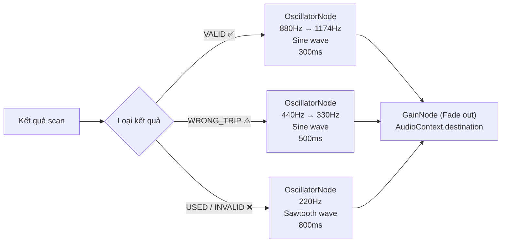
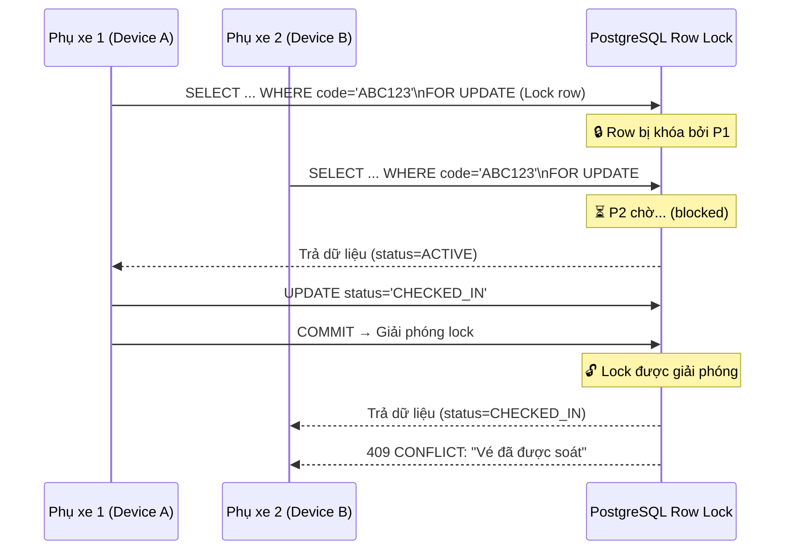
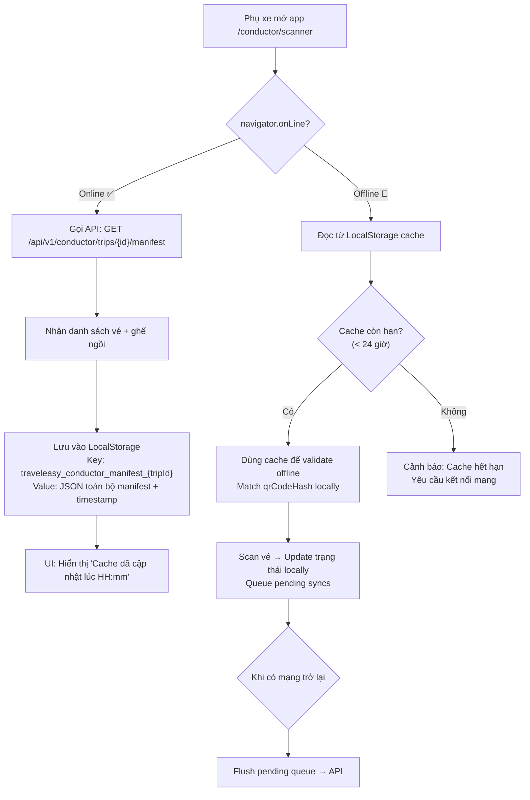
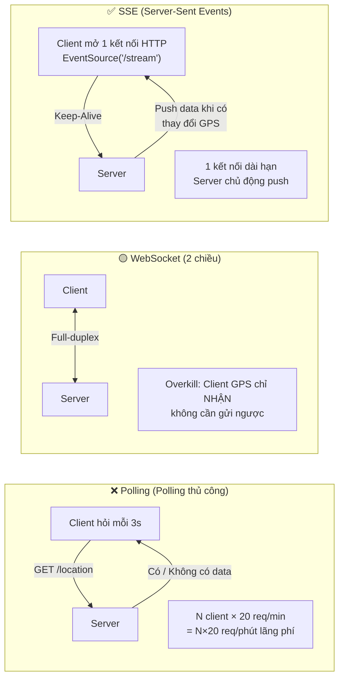
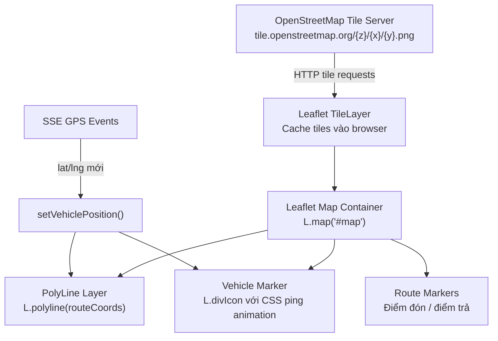
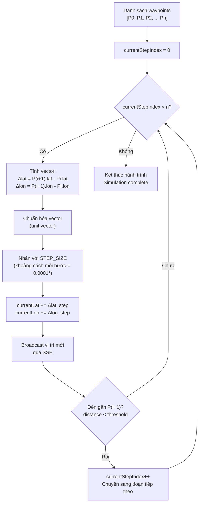
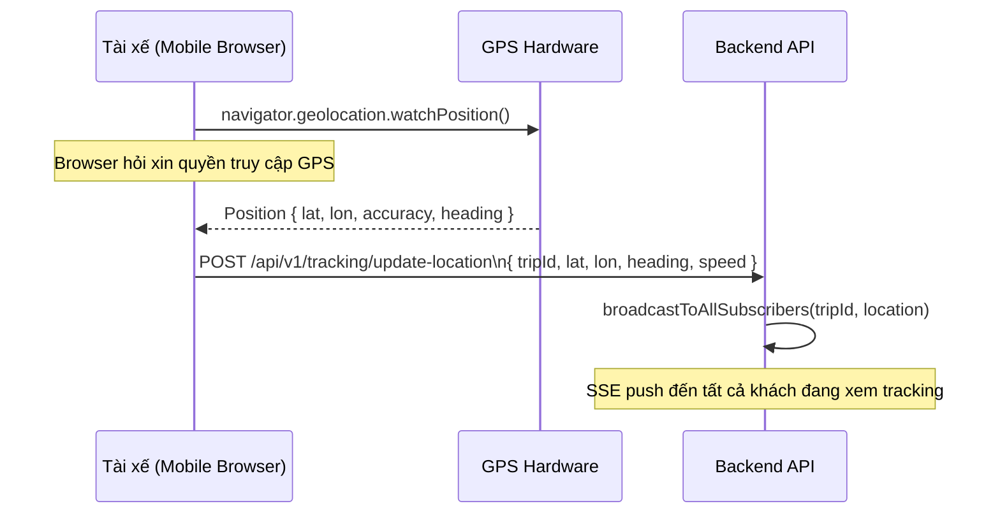
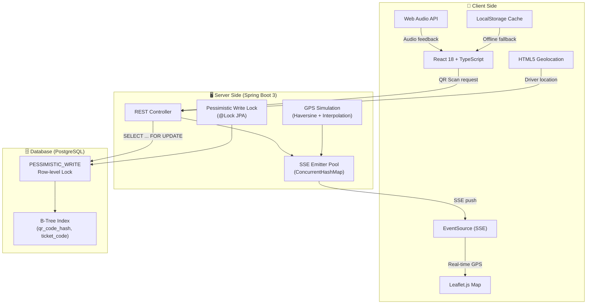

# 🛠️ Công Nghệ & Thuật Toán: Hệ Thống Soát Vé QR & GPS Tracking
> **Dự án:** TravelEasy Platform  
> **Phạm vi:** Sprint [S320] – WebApp Quét QR Soát Vé Di Động & [S306/S419] – GPS Live Tracking  
> **Phụ trách:** Đoàn Nhật Cường (@joshliam)  
> **Tài liệu liên quan:** [Kịch bản thuyết trình bảo vệ](./KICH_BAN_THUYET_TRINH_BAO_VE_SOAT_VE_QR_VA_GPS_TRACKING.md)

---

## 📊 Bảng Tổng Hợp Công Nghệ (Technology Stack Overview)

| Hạng mục | Công nghệ / Thư viện | Phiên bản | Vai trò |
|---|---|---|---|
| **Frontend Framework** | React | 18.x | Xây dựng UI SPA |
| **Ngôn ngữ** | TypeScript | 5.x | Type-safe code |
| **Build Tool** | Vite | 5.x | Dev server & bundler |
| **Styling** | Tailwind CSS | 3.x | Utility-first CSS |
| **Icons** | Lucide React | latest | Icon components |
| **Bản đồ** | Leaflet.js + React-Leaflet | 1.9.x | Render map tương tác |
| **Map Tiles** | OpenStreetMap | - | Dữ liệu bản đồ miễn phí |
| **Backend Framework** | Spring Boot | 3.x | REST API & SSE server |
| **Ngôn ngữ Backend** | Java | 17 | Type-safe, OOP |
| **ORM** | JPA / Hibernate | 6.x | Database abstraction |
| **Database** | PostgreSQL (Supabase) | 15.x | Relational DB |
| **Browser Audio** | Web Audio API (native) | - | Phản hồi âm thanh soát vé |
| **Realtime** | Server-Sent Events (SSE) | HTML5 | GPS streaming |
| **Offline** | LocalStorage API (native) | - | Cache manifest chuyến đi |
| **GPS Device** | HTML5 Geolocation API | native | Lấy vị trí thiết bị tài xế |
| **Concurrency** | `ConcurrentHashMap` (Java) | JDK 17 | Thread-safe SSE pool |
| **DB Locking** | Pessimistic Write Lock (JPA) | - | Chống race condition soát vé |

---

## 1. 🔊 Web Audio API — Phản Hồi Âm Thanh Tức Thì

### 1.1 Lý do chọn

Thay vì dùng file `.mp3` phải tải về, **Web Audio API** tổng hợp âm thanh trực tiếp trong RAM của trình duyệt. Điều này đảm bảo:
- **Zero latency:** Không cần mạng để phát âm thanh
- **Offline-ready:** Hoạt động khi mất sóng (đèo, hầm)
- **Nhẹ hơn:** Không tốn băng thông tải file âm thanh

### 1.2 Cơ chế hoạt động



### 1.3 Chi tiết tần số

| Trạng thái vé | Màu UI | Dạng sóng | Tần số | Thời gian |
|---|---|---|---|---|
| Hợp lệ ✅ | Xanh lá | `sine` | 880 Hz → 1174 Hz | 300 ms |
| Sai chuyến / Sai ngày ⚠️ | Vàng | `sine` | 440 Hz → 330 Hz | 500 ms |
| Đã dùng / Không hợp lệ ❌ | Đỏ | `sawtooth` | 220 Hz (giữ nguyên) | 800 ms |

> **Lưu ý kỹ thuật:** `sawtooth` tạo tiếng "khó chịu" hơn `sine` — cố tình dùng để tạo cảm giác cảnh báo rõ ràng hơn về mặt tâm lý âm thanh.

### 1.4 Code pattern

```typescript
const playBeep = (type: 'success' | 'warning' | 'error') => {
  const ctx = new AudioContext();
  const osc = ctx.createOscillator();
  const gain = ctx.createGain();

  osc.connect(gain);
  gain.connect(ctx.destination);

  // Cấu hình theo loại kết quả
  osc.type = type === 'error' ? 'sawtooth' : 'sine';
  osc.frequency.setValueAtTime(startFreq, ctx.currentTime);
  osc.frequency.linearRampToValueAtTime(endFreq, ctx.currentTime + duration);

  // Fade-out để tránh "pop" âm thanh
  gain.gain.setValueAtTime(0.3, ctx.currentTime);
  gain.gain.exponentialRampToValueAtTime(0.001, ctx.currentTime + duration);

  osc.start(ctx.currentTime);
  osc.stop(ctx.currentTime + duration);
};
```

---

## 2. 🔒 Pessimistic Write Lock — Chống Race Condition Đồng Thời

### 2.1 Vấn đề cần giải quyết

Khi xe đông khách, **nhiều thiết bị** (phụ xe 1 & phụ xe 2) có thể quét **cùng một vé** trong cùng một mili-giây. Nếu không khóa, cả hai đều đọc `status = ACTIVE` → cả hai đều check-in thành công → **1 vé dùng được 2 lần**.

### 2.2 Giải pháp: Pessimistic Write Lock



### 2.3 Triển khai trong code

```java
// ConductorScannerController.java
@Lock(LockModeType.PESSIMISTIC_WRITE)  // ← Khóa hàng DB
@Query("SELECT t FROM Ticket t WHERE t.qrCodeHash = :hash")
Optional<Ticket> findByQrCodeHashWithLock(@Param("hash") String hash);

@Transactional  // ← Bao toàn bộ logic trong 1 transaction
public ScanResult validateAndCheckIn(String qrCode) {
    Ticket ticket = repo.findByQrCodeHashWithLock(hash)
        .orElseThrow(() -> new TicketNotFoundException());
    // Tại đây row đã bị lock — thread khác phải chờ
    if (ticket.getStatus() == CHECKED_IN) {
        return ScanResult.ALREADY_USED;
    }
    ticket.setStatus(CHECKED_IN);
    ticket.setCheckedInAt(LocalDateTime.now());
    return ScanResult.VALID;
    // Khi method kết thúc → COMMIT → lock giải phóng
}
```

### 2.4 So sánh với Optimistic Lock

| Tiêu chí | Pessimistic Lock ✅ (đang dùng) | Optimistic Lock |
|---|---|---|
| Cơ chế | Khóa DB ngay khi đọc | Dùng `@Version` field, check khi ghi |
| Phù hợp khi | Xung đột xảy ra **thường xuyên** | Xung đột xảy ra **hiếm** |
| Risk | Deadlock nếu không cẩn thận | Retry storm khi nhiều conflict |
| Use case | Soát vé đông người ✅ | Cập nhật profile ✅ |

---

## 3. 📦 Offline-First / Trip Manifest Cache Pattern

### 3.1 Vấn đề

Xe buýt chạy qua **đèo, hầm, vùng núi** mất sóng 4G. Phụ xe vẫn phải soát vé liên tục.

### 3.2 Kiến trúc Offline-First



### 3.3 Cấu trúc LocalStorage

```json
// Key: "traveleasy_conductor_manifest_<tripId>"
{
  "tripId": 42,
  "tripCode": "SG-DN-001",
  "cachedAt": "2025-11-20T07:30:00Z",
  "expiresAt": "2025-11-21T07:30:00Z",
  "tickets": [
    {
      "ticketCode": "TKT-ABC123",
      "qrCodeHash": "sha256:a3f9c...",
      "seatNumber": "A12",
      "passengerName": "Nguyễn Văn A",
      "status": "ACTIVE"
    }
  ],
  "pendingSyncs": []
}
```

### 3.4 Event Listener theo dõi kết nối mạng

```typescript
// QrTicketScannerPage.tsx
useEffect(() => {
  const handleOnline = () => {
    setIsOnline(true);
    flushPendingQueue();     // Đẩy các scan offline lên server
    refreshManifest();       // Làm mới cache
  };
  const handleOffline = () => setIsOnline(false);

  window.addEventListener('online', handleOnline);
  window.addEventListener('offline', handleOffline);
  return () => {
    window.removeEventListener('online', handleOnline);
    window.removeEventListener('offline', handleOffline);
  };
}, []);
```

---

## 4. 📡 Server-Sent Events (SSE) — GPS Streaming Thời Gian Thực

### 4.1 Tại sao SSE thay vì WebSocket hay Polling?



| Tiêu chí | Polling | WebSocket | SSE ✅ |
|---|---|---|---|
| Hướng dữ liệu | 2 chiều (lãng phí) | 2 chiều | 1 chiều (Server→Client) |
| Phức tạp | Thấp | Cao | **Trung bình** |
| Tương thích | Tốt | Tốt | **Tốt** (HTTP/1.1+) |
| Tự kết nối lại | Không | Không | **Có (auto-reconnect)** |
| Phù hợp GPS | ❌ | 🟡 | ✅ |

### 4.2 Triển khai Spring Boot SSE

```java
// TripGpsController.java
@GetMapping(value = "/stream/{tripId}", produces = MediaType.TEXT_EVENT_STREAM_VALUE)
public SseEmitter streamGps(@PathVariable Long tripId) {
    SseEmitter emitter = new SseEmitter(Long.MAX_VALUE); // Kết nối vô thời hạn
    gpsService.addSubscriber(tripId, emitter);

    emitter.onCompletion(() -> gpsService.removeSubscriber(tripId, emitter));
    emitter.onTimeout(() -> gpsService.removeSubscriber(tripId, emitter));
    return emitter;
}

// Khi tài xế cập nhật vị trí → broadcast cho tất cả subscriber
public void broadcastLocation(Long tripId, GpsLocation loc) {
    List<SseEmitter> emitters = subscriberPool.get(tripId);
    emitters.forEach(emitter -> {
        try {
            emitter.send(SseEmitter.event().data(loc));
        } catch (IOException e) {
            emitter.completeWithError(e);
        }
    });
}
```

### 4.3 Triển khai EventSource (Frontend)

```typescript
// LiveTrackingMapPage.tsx
useEffect(() => {
  const es = new EventSource(`/api/v1/tracking/stream/${tripId}`);

  es.onmessage = (event) => {
    const loc: GpsLocation = JSON.parse(event.data);
    setVehiclePosition([loc.latitude, loc.longitude]);
    setHeading(loc.heading);
    updatePolyline(loc); // Thêm điểm vào đường route
  };

  es.onerror = () => {
    // Browser tự động reconnect sau 3 giây
    console.warn('SSE connection lost, retrying...');
  };

  return () => es.close(); // Cleanup khi unmount
}, [tripId]);
```

---

## 5. 🗺️ Leaflet.js — Render Bản Đồ & Thuật Toán Tracking

### 5.1 Kiến trúc render bản đồ



### 5.2 Thuật toán Dynamic Marker Rotation (Hướng Xe)

**Vấn đề:** Biểu tượng xe 🚌 trên bản đồ cần quay đúng hướng xe đang di chuyển.

**Thuật toán tính heading từ 2 tọa độ GPS:**

$$\text{heading} = \text{atan2}(\Delta\text{lon}, \Delta\text{lat}) \times \frac{180}{\pi}$$

```typescript
// Tính góc quay từ điểm GPS trước → điểm GPS hiện tại
const calculateHeading = (prev: LatLng, current: LatLng): number => {
  const dLat = current.lat - prev.lat;
  const dLon = current.lng - prev.lng;
  const angle = Math.atan2(dLon, dLat) * (180 / Math.PI);
  return (angle + 360) % 360; // Chuẩn hóa về [0, 360]
};

// Áp dụng vào DivIcon
const busIcon = L.divIcon({
  html: `<div style="transform: rotate(${heading}deg); transition: transform 0.5s ease;">
           <span class="bus-marker">🚌</span>
         </div>`,
  className: 'custom-bus-icon'
});
```

### 5.3 Thuật toán Re-center Animation (S419)

```typescript
// LiveTrackingMapPage.tsx — Nút "Về tâm xe"
const handleRecenter = () => {
  if (mapRef.current && vehiclePosition) {
    mapRef.current.panTo(vehiclePosition, {
      animate: true,
      duration: 1.0,        // 1 giây animation mượt mà
      easeLinearity: 0.25   // Ease curve (Cubic Bezier-like)
    });
    setIsUserPanning(false); // Reset flag "user đang kéo bản đồ"
  }
};
```

### 5.4 Polyline Route Rendering

```typescript
// Vẽ đường đi đã qua (màu xanh) và đường còn lại (màu xám)
const traveledPath = L.polyline(pastCoordinates, {
  color: '#3B82F6',   // blue-500
  weight: 4,
  opacity: 0.8
});

const remainingPath = L.polyline(futureCoordinates, {
  color: '#9CA3AF',   // gray-400
  weight: 3,
  opacity: 0.5,
  dashArray: '8, 6'  // Nét đứt cho đường chưa đi
});
```

---

## 6. 🏎️ GPS Interpolation / Route Simulation Algorithm

### 6.1 Mục đích

Khi demo hoặc test không có xe thực, hệ thống mô phỏng xe di chuyển từng bước dọc theo route đã định sẵn.

### 6.2 Thuật toán `advanceSimulationStep()`



### 6.3 Tính khoảng cách Haversine

Dùng để kiểm tra xe đã đến waypoint tiếp theo chưa:

$$d = 2r \cdot \arcsin\left(\sqrt{\sin^2\!\left(\frac{\Delta\phi}{2}\right) + \cos\phi_1 \cdot \cos\phi_2 \cdot \sin^2\!\left(\frac{\Delta\lambda}{2}\right)}\right)$$

Trong đó: $r = 6371$ km (bán kính Trái Đất), $\phi$ = latitude (radian), $\lambda$ = longitude (radian).

```java
// TripGpsRealtimeService.java
private double haversineDistance(double lat1, double lon1, double lat2, double lon2) {
    double R = 6371000; // mét
    double dLat = Math.toRadians(lat2 - lat1);
    double dLon = Math.toRadians(lon2 - lon1);
    double a = Math.sin(dLat/2) * Math.sin(dLat/2)
             + Math.cos(Math.toRadians(lat1)) * Math.cos(Math.toRadians(lat2))
             * Math.sin(dLon/2) * Math.sin(dLon/2);
    return R * 2 * Math.atan2(Math.sqrt(a), Math.sqrt(1-a));
}
```

---

## 7. 🏦 B-Tree Index — Tối Ưu Hóa Truy Vấn Vé

### 7.1 Vấn đề hiệu năng

Bảng `tickets` có thể chứa hàng triệu bản ghi. Mỗi lần quét QR → 1 `SELECT WHERE qr_code_hash = ?`. Full table scan = **không chấp nhận được** trong môi trường realtime.

### 7.2 Giải pháp: Composite B-Tree Index

```sql
-- Migration SQL
CREATE INDEX idx_tickets_qr_lookup
    ON tickets (ticket_code, qr_code_hash);

-- Query tận dụng index (sub-15ms)
SELECT * FROM tickets
WHERE qr_code_hash = 'sha256:a3f9c...'
  AND status = 'ACTIVE';
```

### 7.3 Cơ chế B-Tree Index

```
                    [Root Node]
                   /           \
          [Internal M]      [Internal Z]
          /    \               /    \
      [sha:a3] [sha:m7]   [sha:t2] [sha:z9]
      ↓                    ↓
  Leaf: Row pointer      Leaf: Row pointer
  → Disk Page 42         → Disk Page 97
```

- **Độ phức tạp tra cứu:** O(log n) thay vì O(n) full scan
- **Với 1,000,000 vé:** B-Tree chỉ cần ~20 bước so sánh thay vì 1,000,000

---

## 8. 🌐 HTML5 Geolocation API — GPS Từ Thiết Bị Tài Xế

### 8.1 Luồng lấy GPS



### 8.2 Triển khai

```typescript
// DriverShareLocationPage.tsx (giả định)
const startSharing = () => {
  const watchId = navigator.geolocation.watchPosition(
    (position) => {
      const { latitude, longitude, heading, speed } = position.coords;
      api.post('/tracking/update-location', {
        tripId,
        latitude,
        longitude,
        heading: heading ?? calculatedHeading,
        speed: speed ?? 0,
        accuracy: position.coords.accuracy
      });
    },
    (error) => console.error('GPS error:', error),
    {
      enableHighAccuracy: true,  // Dùng GPS chip thay vì WiFi/Cell tower
      maximumAge: 1000,          // Cache vị trí tối đa 1 giây
      timeout: 5000              // Timeout nếu không lấy được vị trí
    }
  );
};
```

---

## 9. 🔄 ConcurrentHashMap Subscriber Pool Pattern

### 9.1 Vấn đề đa luồng

Spring Boot xử lý mỗi HTTP request trên một thread riêng. Khi 100 khách mở trang tracking cùng lúc → 100 `SseEmitter` cần được lưu và quản lý **thread-safe**.

### 9.2 Giải pháp

```java
// TripGpsRealtimeService.java
@Service
public class TripGpsRealtimeService {

    // Key: tripId, Value: danh sách emitters của chuyến đó
    private final ConcurrentHashMap<Long, CopyOnWriteArrayList<SseEmitter>>
        subscriberPool = new ConcurrentHashMap<>();

    public void addSubscriber(Long tripId, SseEmitter emitter) {
        // computeIfAbsent là atomic — thread-safe
        subscriberPool
            .computeIfAbsent(tripId, k -> new CopyOnWriteArrayList<>())
            .add(emitter);
    }

    public void removeSubscriber(Long tripId, SseEmitter emitter) {
        List<SseEmitter> list = subscriberPool.get(tripId);
        if (list != null) {
            list.remove(emitter); // CopyOnWriteArrayList: safe khi iterate
        }
    }
}
```

### 9.3 Tại sao `CopyOnWriteArrayList` thay vì `ArrayList`?

| | `ArrayList` | `CopyOnWriteArrayList` ✅ |
|---|---|---|
| Thread-safe | ❌ `ConcurrentModificationException` | ✅ |
| Cơ chế | Shared mutable array | Copy array khi ghi |
| Phù hợp | 1 thread | **Nhiều thread đọc, ít ghi** ✅ |
| Use case | - | Danh sách SSE subscribers |

---

## 10. 🎯 Tổng Hợp: Mối Quan Hệ Giữa Các Công Nghệ



---

## 📚 Tài Liệu Tham Khảo

| Nguồn | Link |
|---|---|
| Web Audio API (MDN) | https://developer.mozilla.org/en-US/docs/Web/API/Web_Audio_API |
| Server-Sent Events (MDN) | https://developer.mozilla.org/en-US/docs/Web/API/Server-sent_events |
| Leaflet.js Documentation | https://leafletjs.com/reference.html |
| Spring Data JPA Locking | https://docs.spring.io/spring-data/jpa/docs/current/reference/html/#jpa.locking |
| HTML5 Geolocation API | https://developer.mozilla.org/en-US/docs/Web/API/Geolocation_API |
| Haversine Formula | https://en.wikipedia.org/wiki/Haversine_formula |
| ConcurrentHashMap (Java) | https://docs.oracle.com/en/java/api/java.base/java/util/concurrent/ConcurrentHashMap.html |
| OpenStreetMap Tile Usage | https://wiki.openstreetmap.org/wiki/Tile_usage_policy |

---

*Tài liệu này được tạo phục vụ buổi bảo vệ dự án OJT-IV — TravelEasy Platform.*  
*Cập nhật lần cuối: Tháng 11/2025 — Đoàn Nhật Cường (@joshliam)*
