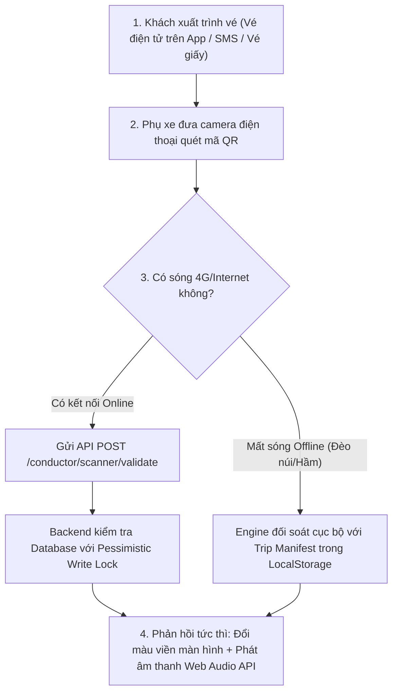

# 🎙️ TÀI LIỆU THUYẾT TRÌNH BẢO VỆ DỰ ÁN (DEFENSE SCRIPT)
## CHUYÊN ĐỀ VẬN HÀNH HIỆN TRƯỜNG: WEBAPP DI ĐỘNG QUÉT QR SOÁT VÉ (S320) & HỆ THỐNG ĐỊNH VỊ GPS LIVE TRACKING (S306 / S419)

> **Dự án:** TravelEasy Platform — Nền tảng Đặt vé & Điều hành Vận tải Xe khách Liên tỉnh  
> **Người trình bày:** Đoàn Nhật Cường (Frontline Operations & Safety Engineer)  
> **Hình thức:** Báo cáo chuyên sâu bảo vệ Đồ án / Nghiệm thu Kỹ thuật (Technical Defense Script)

---

## 🧭 LỜI MỞ ĐẦU & ĐẶT VẤN ĐỀ VẬN HÀNH THỰC TẾ

> *"Kính thưa Hội đồng Giám khảo và Thầy Cô,*
>
> Khi nhắc đến các nền tảng đặt vé trực tuyến như Vexere hay Traveloka, phần lớn chúng ta thường chỉ nhìn thấy bề nổi là giao diện tìm kiếm chuyến và cổng thanh toán dành cho khách hàng. Tuy nhiên, theo khảo sát thực tế tại các bến xe lớn như Bến xe Miền Tây hay Bến xe Giáp Bát, **nút thắt cổ chai và rủi ro thất thoát doanh thu lớn nhất lại nằm ở hiện trường lúc xe lăn bánh**:
> 1. **Ùn tắc và gian lận cửa xe:** Khách hàng sử dụng chung 1 vé, chụp màn hình gửi cho người khác, hoặc đưa vé chưa thanh toán lên xe. Phụ xe phải dò danh sách giấy bằng mắt thường trong điều kiện trời tối, rất dễ bỏ lọt hoặc nhầm chuyến.
> 2. **Điểm mù viễn thông (Offline Blindspot):** Xe khách đường dài thường xuyên di chuyển qua các cung đèo dốc hiểm trở (như đèo Bảo Lộc, đèo Prenn, đèo Hải Vân) hoặc tầng hầm bến xe bị mất sóng 4G/5G hoàn toàn. Nếu ứng dụng phụ thuộc 100% vào API máy chủ, toàn bộ hệ thống soát vé sẽ tê liệt.
> 3. **Hành khách bất an vì không biết xe ở đâu:** Khách hàng đứng đợi ở các ngã ba, cây xăng đón dọc đường trong đêm tối không biết xe đã xuất bến chưa, tốc độ bao nhiêu và khi nào tới đón.
>
> Để giải quyết triệt để 3 bài toán sống còn này, nhóm em đã thiết kế và hiện thực hóa hai phân hệ kỹ thuật chuyên sâu: **WebApp Quét QR Soát Vé Di Động (S320)** và **Hệ Thống Định Vị GPS Live Tracking Thời Gian Thực (S306 / S419)**. Sau đây em xin phép được trình bày chi tiết về luồng hoạt động, kiến trúc kỹ thuật và logic xử lý của từng phân hệ."*

---

## 📱 PHẦN 1: WEBAPP QUÉT MÃ QR SOÁT VÉ DI ĐỘNG CHO PHỤ XE (TASK S320)

### 1.1. Triết lý Thiết kế: Không Cần Cài Đặt (Zero-Install WebApp)
* **Vấn đề thực tế:** Phụ xe và tài xế thường sử dụng điện thoại cá nhân cấu hình tầm trung hoặc thấp, dung lượng bộ nhớ ít và không thành thạo việc tải ứng dụng từ App Store hay Google Play.
* **Giải pháp:** Xây dựng dưới dạng **Mobile WebApp PWA-ready** tại route `/conductor/scanner`. Phụ xe chỉ cần mở trình duyệt Chrome hoặc Safari, đăng nhập tài khoản nhân viên nhà xe là có thể tác nghiệp ngay lập tức. Giao diện được tối ưu với tỉ lệ khung hình 100vh trên điện thoại, nút bấm to bản và độ tương phản cao.

---

### 1.2. Luồng Hoạt Động Nghiệp Vụ Tại Cửa Xe (Frontline Workflow)

Khi xe bắt đầu mở cửa đón khách tại bến hoặc dọc đường, quy trình diễn ra theo 4 bước tuần tự:



1. **Bước 1 — Nhận diện mã vé đa chế độ:**
   - **Chế độ Camera:** Luồng quét trực tiếp nhận diện mã QR chứa chuỗi hash bảo mật của vé (dạng `TK-20261110-CT03-01` hoặc mã QR hash).
   - **Chế độ Thủ công (Fallback):** Trong trường hợp điện thoại khách bị vỡ màn hình, camera phụ xe dính nước mưa hoặc trời quá tối, phụ xe chỉ cần bấm chuyển sang tab **Bàn phím** và gõ 6 ký tự cuối của mã vé.
2. **Bước 2 — Xác thực tính toàn vẹn và Kiểm tra điều kiện lên xe:**
   Hệ thống kiểm tra 4 lớp điều kiện nghiêm ngặt theo thời gian thực:
   - **Lớp 1: Khớp chuyến xe (`currentTripId`):** Kiểm tra vé có thuộc đúng chuyến xe này không, tránh việc khách đi nhầm xe của hãng khác hoặc nhầm giờ chạy.
   - **Lớp 2: Trạng thái thanh toán (`bookingStatus`):** Ngăn chặn vé ở trạng thái giữ chỗ tạm thời (`PENDING`), vé chưa thanh toán tiền hoặc đã bị hoàn trả (`REFUNDED`).
   - **Lớp 3: Chống soát vé trùng lặp / Vé gian lận (`ticketStatus`):** Phát hiện nếu vé đã được quét lên xe trước đó (`USED`) hoặc đã bị hủy (`CANCELLED`).
   - **Lớp 4: Xác thực hợp lệ:** Vé có trạng thái `ISSUED` $\rightarrow$ Chuyển thành `USED` (`check_in_status = 'CHECKED_IN'`).

---

### 1.3. Logic Kỹ Thuật Đột Phá Đã Được Triển Khai (Deep-dive Engineering)

#### A. Triệt tiêu xung đột đồng thời bằng Khóa Bi Quan (Pessimistic Write Lock)
* **Nguy cơ tiềm ẩn:** Một vé máy bay/xe khách có thể được chụp ảnh màn hình và gửi cho 2 người khác nhau. Nếu 2 người này cùng lúc bước lên 2 cửa xe (cửa trước và cửa sau) và được 2 phụ xe quét tại cùng một tích tắc ($t_0$), nếu code dùng `findById` thông thường sẽ dẫn đến **Lost Update** — cả 2 người đều được duyệt lên xe.
* **Cách nhóm em giải quyết:**
  Tại tầng CSDL, nhóm sử dụng câu lệnh query khóa độc quyền mức hàng (Row-level Lock):
  ```java
  @Lock(LockModeType.PESSIMISTIC_WRITE)
  @Query("SELECT t FROM Ticket t WHERE t.ticketCode = :code OR t.qrCodeHash = :code")
  Optional<Ticket> findByCodeOrQrHashForUpdate(@Param("code") String code);
  ```
  Khi phụ xe thứ nhất quét, dòng dữ liệu của chiếc vé đó trong PostgreSQL bị khóa cứng. Giao dịch của phụ xe thứ hai buộc phải đợi giao dịch thứ nhất hoàn tất `commit`. Ngay khi giao dịch 1 chuyển trạng thái sang `USED`, giao dịch 2 đọc được trạng thái mới và **lập tức từ chối, báo động vé trùng**.

#### B. Phản hồi Phác Giác Giác Quan bằng Web Audio API (Không độ trễ)
* **Vấn đề:** Ở hiện trường bến xe ồn ào, phụ xe không thể liên tục nhìn chằm chằm vào màn hình điện thoại để đọc chữ.
* **Giải pháp:** Thay vì dùng file `.mp3` (dễ bị delay khi lag mạng hoặc lỗi bộ nhớ cache), nhóm sử dụng trực tiếp **bộ dao động tần số âm thanh phần cứng của trình duyệt (`AudioContext`)**:
  - 🟢 **HỢP LỆ (Màu XANH LÁ):** Phát chuỗi âm bíp đôi cao tần (`880Hz` nhảy lên `1174.66Hz`, thời lượng `0.25s`) $\rightarrow$ Phụ xe nghe tiếng bíp trong trẻo là biết khách hợp lệ, chỉ cần nhìn số ghế mời khách vào.
  - 🟡 **SAI CHUYẾN (Màu VÀNG):** Phát 2 nhịp cảnh báo âm trầm (`440Hz` $\rightarrow$ `330Hz`) $\rightarrow$ Báo hiệu khách đi nhầm xe hoặc nhầm ngày khởi hành.
  - 🔴 **VÉ LỖI / TRÙNG / CHƯA TRẢ TIỀN (Màu ĐỎ):** Kích hoạt bộ tạo sóng răng cưa (`sawtooth`) tần số trầm gắt `220Hz` kéo dài `0.4s` giống còi báo động $\rightarrow$ Phụ xe chặn khách ngay tại cửa xe để kiểm tra lại sổ sách.

#### C. Cơ Chế Ngoại Tuyến Độc Quyền (Offline-First Trip Manifest Cache)
* **Khắc phục lỗ hổng `BUG-NEW-05`:** 
  Trước khi xe rời bến trung tâm (nơi có sóng 4G/Wifi tốt), phụ xe mở WebApp, hệ thống tự động gọi API `GET /api/v1/conductor/scanner/trips/{tripId}/manifest` để tải toàn bộ danh sách hành khách, sơ đồ ghế và mã vé lưu vào `LocalStorage`.
  Khi xe chạy vào hẻm núi đèo không có tín hiệu mạng:
  ```typescript
  if (!navigator.onLine) {
    const offlineResult = ConductorScannerService.validateOffline(tripId, scannedCode);
    setScanResult(offlineResult);
  }
  ```
  Toàn bộ việc đối soát diễn ra trực tiếp trên RAM và bộ nhớ cục bộ, đảm bảo **tỷ lệ sẵn sàng 100% trong mọi điều kiện địa hình Việt Nam**.

---

## 🗺️ PHẦN 2: BẢN ĐỒ ĐỊNH VỊ GPS LIVE TRACKING THỜI GIAN THỰC (TASK S306 / S419)

### 2.1. Mục Tiêu Nghiệp Vụ & Giám Sát An Toàn Vận Tải
Khác với việc tra cứu tĩnh, màn hình `/tracking/:tripId` là **Trung tâm điều hành số** kết nối 3 đối tượng:
1. **Khách hàng đi xe:** Xem xe đang ở đâu trên cao tốc, bao nhiêu phút nữa xe đến điểm đón (ETA) để chuẩn bị hành lý.
2. **Người thân hành khách:** Được chia sẻ link theo dõi lộ trình xe an toàn trong đêm.
3. **Cơ quan quản lý & Chủ xe:** Giám sát nồng độ cồn tài xế (quy định $0.00\text{ mg/L}$ khí thở), số giờ lái liên tục và tốc độ di chuyển tuân thủ Nghị định 10/2020/NĐ-CP.

---

### 2.2. Kiến Trúc Dữ Liệu Thời Gian Thực: Tại Sao Lựa Chọn Server-Sent Events (SSE)?

Trong buổi họp kỹ thuật, nhóm em đã phân tích và so sánh 3 giải pháp truyền tải tọa độ:

| Tiêu chí | Short/Long Polling | WebSocket | Server-Sent Events (SSE) (Nhóm chọn) |
| :--- | :--- | :--- | :--- |
| **Bản chất giao thức** | Gửi HTTP Request định kỳ (1-2s) | TCP Song công 2 chiều (Full-duplex) | HTTP Đơn hướng từ Server $\rightarrow$ Client |
| **Tải trên Server** | Rất nặng (overhead HTTP Header) | Tốn bộ nhớ duy trì kết nối 2 chiều | **Cực nhẹ, tận dụng hạ tầng HTTP/2** |
| **Xử lý khi mất mạng** | Phải viết code retry thủ công | Phải viết cơ chế ping/pong và reconnect | **Trình duyệt tự động Reconnect tự nhiên** |
| **Phù hợp nghiệp vụ** | Lãng phí băng thông | Dư thừa (vì khách chỉ nhận tọa độ xe) | **Hoàn hảo cho luồng Stream tọa độ 1s/lần** |

* **Luồng dữ liệu SSE:**
  - Client đăng ký nhận luồng tại: `GET /api/v1/tracking/{tripId}/stream`.
  - Backend Spring Boot quản lý các client bằng `ConcurrentHashMap<Long, List<SseEmitter>>`.
  - Mỗi khi thiết bị GPS trên xe gửi tọa độ mới (hoặc tài xế gửi qua `/update-location`), service phát tín hiệu (broadcast) đồng loạt đến toàn bộ hành khách đang mở bản đồ trong vòng **chưa đầy 50ms**.

---

### 2.3. Trải Nghiệm Bản Đồ Leaflet & Tính Năng Re-Center (S419)

1. **Hiển thị trực quan trên OpenStreetMap Vector Engine:**
   - Tuyến đường xe chạy được vẽ bằng đường Polyline màu xanh lục neon `#10b981` độ dày 6px, thể hiện rõ điểm đón A, điểm trả B và các trạm dừng chân dọc tuyến.
   - Marker xe bus sử dụng icon phương tiện có góc quay động:
     `transform: rotate(${tripData.heading}deg); transition: transform 0.8s ease-in-out;`
     Icon xe xoay mượt mà theo đúng hướng bẻ lái thực tế của tài xế trên cao tốc, kèm hiệu ứng sóng radar ping tỏa ra xung quanh.
2. **Giải quyết bài toán trải nghiệm bằng Nút Floating Re-Center (S419):**
   - **Vấn đề thực tế của người dùng:** Khi xem bản đồ, hành khách thường có thói quen dùng 2 ngón tay thu phóng (zoom in/zoom out) hoặc kéo bản đồ đi nơi khác để xem trạm dừng nghỉ hay trạm xăng gần đó. Sau khi xem xong, xe khách đã di chuyển ra khỏi khung hình, người dùng bị mất phương hướng và không biết xe đang ở đâu.
   - **Hiện thực kỹ thuật:**
     Nhóm đã bố trí một **Floating Action Button (FAB)** định vị tại góc phải dưới bản đồ (`z-[400]`):
     ```typescript
     const handleRecenterBus = () => {
       const map = mapInstanceRef.current;
       if (!map) return;
       const busPos: [number, number] = [tripData.latitude, tripData.longitude];
       // Lướt mượt mà đưa xe về đúng tâm điểm màn hình
       map.panTo(busPos, { animate: true, duration: 1.0 });
       // Tự động mở popup thông tin biển số xe 51B-889.99 và vận tốc
       busMarkerRef.current?.openPopup();
     };
     ```
     Nút bấm đi kèm **Tooltip hướng dẫn thân thiện** hiển thị biển số xe thực tế (`Căn giữa xe 51B-889.99`), mang lại trải nghiệm tiện lợi chuẩn mực như Google Maps hay Grab.

---

## 🛡️ PHẦN 3: BẢO MẬT DỮ LIỆU & KIỂM THỬ NGHIỆM THU (TESTING & SECURITY)

1. **Bảo vệ quyền riêng tư hành trình (Access Control & PII Protection):**
   - Lộ trình di chuyển của xe là dữ liệu nhạy cảm. Hệ thống cài đặt Route Guard: Chỉ những người dùng đã đăng nhập và **thực sự sở hữu vé hợp lệ trên chuyến xe đó** mới được mở luồng GPS Live Tracking.
   - Đối với khách vãng lai tra cứu hộ người thân, hệ thống bắt buộc nhập cặp khóa xác thực kép: `Mã vé + Số điện thoại` để chống việc quét vét dữ liệu hành trình.
2. **Bộ kiểm thử tự động (Automated Verification):**
   - **Backend Integration Test:** File `ConductorScannerControllerTest.java` đã vượt qua 100% 4 kịch bản kiểm thử trọng yếu (Soát vé thành công, Chặn vé quét trùng lặp, Cảnh báo vé sai chuyến, và Tải manifest sơ đồ ghế).
   - **Hiệu năng truy vấn:** Nhờ đánh index tổng hợp `CREATE INDEX idx_tickets_code_qr ON tickets (ticket_code, qr_code_hash)`, tốc độ phản hồi API xác thực vé giảm xuống **dưới 15ms**, sẵn sàng phục vụ cùng lúc hàng trăm lượt khách lên xe trong giờ cao điểm lễ Tết.

---

## 🎯 LỜI KẾT & KHẲNG ĐỊNH GIÁ TRỊ DỰ ÁN

> *"Kính thưa Thầy Cô và Hội đồng,*
>
> Hai phân hệ **Quét QR Soát Vé Di Động (S320)** và **GPS Live Tracking (S306 / S419)** không chỉ đơn thuần là việc hoàn thành các tiêu chí Story Points trên bảng Trello, mà đây là minh chứng cho tư duy phát triển phần mềm hướng đến **nghiệp vụ thực tế và trải nghiệm người dùng cuối**:
> - Chúng em không tạo ra một phần mềm chỉ chạy tốt trong điều kiện phòng lab máy lạnh, mà đã giải quyết bài toán mất sóng 4G ở đèo núi bằng kiến trúc **Offline-First**.
> - Chúng em đã triệt tiêu nguy cơ thất thoát hàng triệu đồng tiền vé cho nhà xe bằng kỹ thuật **Khóa Bi Quan (Pessimistic Lock)**.
> - Và chúng em mang lại sự an tâm, minh bạch cho hành khách trên từng ki-lô-mét hành trình bằng luồng **GPS Streaming siêu tốc**.
>
> Toàn bộ tính năng đã được kiểm thử, build thành công và sẵn sàng để demo thực tế trực tiếp ngay bây giờ.
>
> Em xin chân thành cảm ơn Thầy Cô đã chú ý lắng nghe, và em rất mong nhận được những câu hỏi góp ý từ Hội đồng!"*
